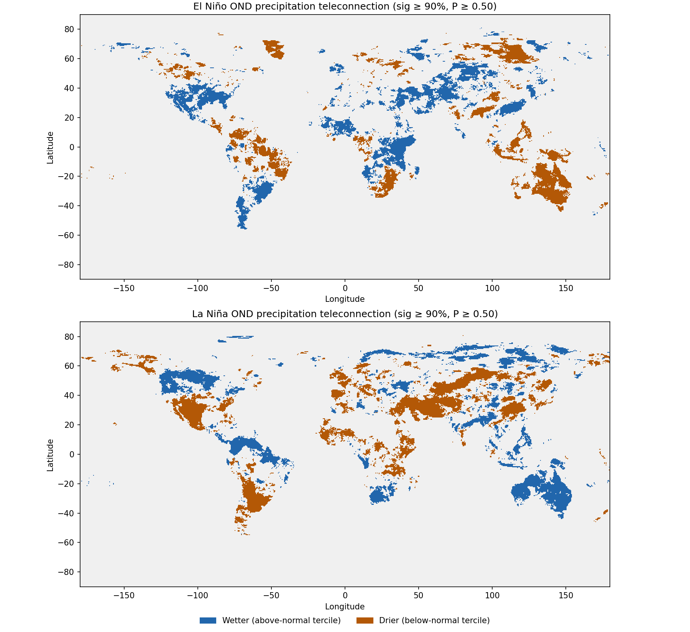

# OND ENSO Precipitation Teleconnection Masks

Global masks of where El Niño and La Niña historically shift October–December (OND) precipitation toward wetter or drier conditions. They are built from the Lenssen et al. (2020) ENSO teleconnection probabilities hosted on the IRI Data Library.



## Quick start

```bash
python -m pip install xarray netCDF4 rioxarray matplotlib
python build_ond_masks.py                                   # defaults: 90% significance, P >= 0.5
python build_ond_masks.py --significance 95 --min-prob 0.6  # stricter masks
```

| Option | Default | Meaning |
|---|---|---|
| `--significance` | `90` | Statistical significance level: `85`, `90`, `95` or `99` |
| `--min-prob` | `0.5` | Minimum tercile probability (the climatological baseline is 1/3) |
| `--out` | `outputs` | Output directory |

The whole global OND slice is only a few MB, so a run takes well under a minute.

## Source data

- **Dataset:** `http://iridl.ldeo.columbia.edu/home/.lenssen/.ensoTeleconnections/dods` (OPeNDAP)
- **Reference:** Lenssen et al. (2020), as given in the dataset metadata ("Lenssen et al. 2020 Results"). Check the paper for the precipitation source and ENSO event definition before citing.
- **Variable:** `prob`, the probability that seasonal precipitation falls in the upper or lower tercile during an ENSO event

| Dimension | Values | Notes |
|---|---|---|
| `significance` | 85, 90, 95, 99 | Cells not significant at this level are NaN |
| `anomaly` | `Above_Normal`, `Below_Normal` | Wetter / drier tercile |
| `ENSO` | `ElNino`, `LaNina` | Stored as bytes (`b'ElNino'`); the script decodes them |
| `T` | 0.5 … 11.5 | Centre month of a 3-month season, in months since 1960-01. **OND = 10.5** (0.5 = DJF) |
| `Y` | −89.75 → 89.75 | 0.5° grid, ascending |
| `X` | −179.75 → 179.75 | 0.5° grid |

## Method

1. Open the dataset lazily over OPeNDAP (`decode_times=False`, because `T` is a 360-day month index, not a date).
2. Decode the byte-string coordinates so the script can select them by name.
3. Select `T=10.5` (OND) at the chosen significance level, then download the global slice.
4. For each ENSO phase:
   - **wet mask:** `Above_Normal` probability is non-NaN (significant) and ≥ `min_prob`
   - **dry mask:** `Below_Normal` probability is non-NaN (significant) and ≥ `min_prob`
   - **combined:** `wet − dry` gives +1 wetter, −1 drier, 0 no signal. A few cells pass both tests, because with small samples both probabilities can equal exactly 0.5. These are set to 0 and reported as a warning.
5. Write GeoTIFFs (flipped north-up, EPSG:4326, deflate-compressed), one NetCDF and an overview PNG.

## Outputs

File names carry the settings, e.g. `_OND_sig90_p50`, so different runs don't overwrite each other.

| File | Type | Content |
|---|---|---|
| `{ElNino,LaNina}_{wet,dry}_mask_*.tif` | uint8 | 1 = teleconnection present, 0 = absent |
| `{ElNino,LaNina}_{wet,dry}_prob_*.tif` | float32 | Tercile probability; NaN = not significant |
| `{ElNino,LaNina}_combined_*.tif` | int8 | +1 wetter, −1 drier, 0 no signal |
| `enso_masks_*.nc` | NetCDF | All probability, mask and combined layers, with settings in the attributes |
| `enso_masks_*.png` | PNG | Two-panel global overview |

In the combined and mask rasters, 0 covers both "no signal" and "no data" (e.g. ocean). Use the probability rasters to tell the two apart.

### Results at the defaults (90% significance, P ≥ 0.5)

| Phase | Wet cells | Dry cells | Significant cells | Cells flagged both (set to 0) |
|---|---|---|---|---|
| El Niño | 10,613 | 9,354 | 22,435 | 24 |
| La Niña | 11,606 | 12,579 | 24,531 | 30 |

The masks reproduce the known OND patterns. Under El Niño, East Africa (the short rains) and southeast South America are wetter, while Indonesia, Australia and southern Africa are drier. La Niña largely reverses these. Spot checks of the El Niño combined raster: Kenya +1, eastern Australia −1, Uruguay/southern Brazil +1.

## Why the original approach was changed

This workflow began from an AI-generated snippet that did not match the real dataset. The fixes:

| Original | Problem | Fix |
|---|---|---|
| `ds['prob_dry']` | Variable doesn't exist | `ds['prob']` with `anomaly="Below_Normal"` |
| `ENSO_State=1.0` | Dimension doesn't exist | `ENSO="ElNino"` (after decoding the bytes) |
| `Season=11.0` for OND | Wrong dimension name and value | `T=10.5` |
| No `significance` selection | Result stays 4-D; `.plot()` draws a histogram | Select one level (default 90%) |
| El Niño → dry Horn of Africa in OND | Physically backwards; that mask is empty | El Niño makes the OND short rains *wetter* |
| Threshold `> 0.40` | No effect: non-significant cells are already NaN and the smallest remaining value is ~0.42 | Use significance level + `P ≥ 0.5` (1.5× climatological odds) |
| "Probability of dry extremes" | These are terciles, not extremes | Described as "below/above-normal tercile" |
| `where()` probability field as the "mask" | Not a binary mask | Export 0/1 masks, plus probabilities separately |
| `rio.to_raster` without setup | No CRS, no spatial dims, south-up | `import rioxarray`, set dims and CRS, sort Y descending |

## Caveats

- **Small samples.** Each probability rests on roughly 10–20 historical El Niño or La Niña events, which is why values come in coarse fractions such as 5/11. Prefer 90–95% significance for decisions.
- **Historical, not a forecast.** The masks show where ENSO has historically shifted OND rainfall odds. Combine them with the current ENSO outlook; they are not a forecast themselves.
- **Terciles, not extremes.** "Drier" means a higher chance of a below-normal (bottom-third) season, not drought or extreme-event probability.
- **Environment note.** Installing these packages upgraded `packaging` past what `streamlit` allows. It was pinned back with `pip install "packaging<26"`.
